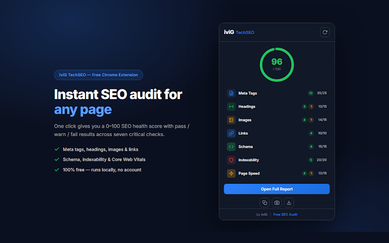
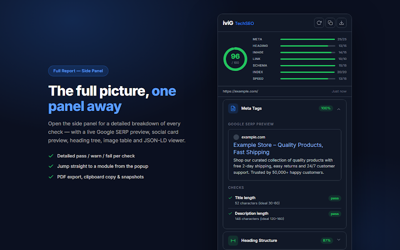
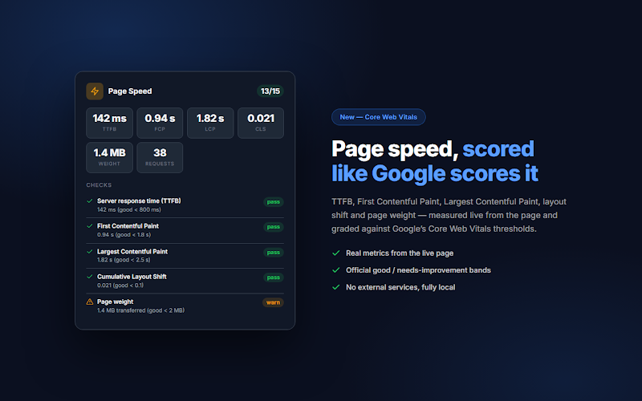
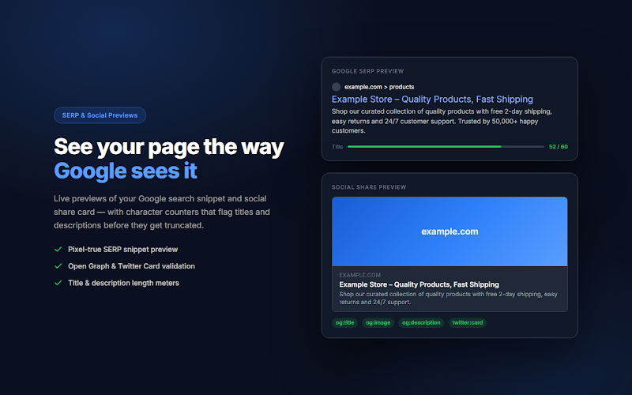
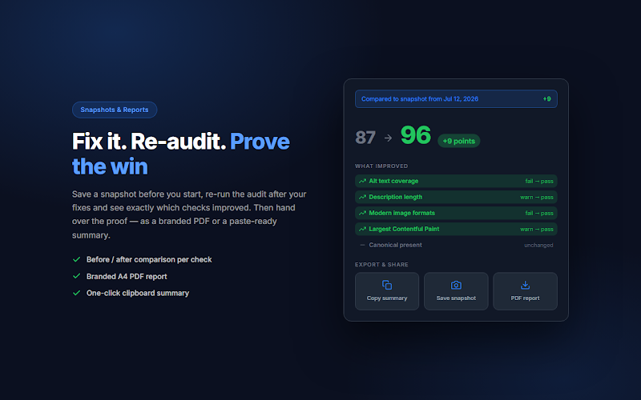

# TechSEO Inspector


[](LICENSE)

**A free Chrome extension that audits the page you're on and gives it an SEO score from 0 to 100.**

Click the icon on any page and you get a score across seven areas: meta tags, headings, images, links, schema, indexability and page speed. Every check is marked pass, warn or fail, with the reason spelled out. Open the side panel for the full breakdown.

No account, no analytics, no tracking. The audit runs in your browser.

[**Install from the Chrome Web Store**](https://chromewebstore.google.com/detail/techseo-inspector/pamgfjigokjaffaeldmgbiimjgjfmppj) · [Project page](https://ivig.dev/techseo-inspector/)



## What it checks

| Area | Weight | Checks |
| --- | --- | --- |
| Meta tags | 25 | Title present and 30 to 60 characters, meta description present and 120 to 160 characters, Open Graph (`og:title`, `og:description`, `og:image`, `og:url`, `og:type`), Twitter Card tags (falls back to Open Graph where Twitter does) |
| Indexability | 20 | No `noindex`, canonical present and self-referencing, robots meta, `X-Robots-Tag` header, `robots.txt` rules for the page |
| Headings | 15 | Exactly one H1, heading hierarchy without skipped levels, no empty headings, reasonable heading count |
| Images | 15 | Alt text coverage, no empty alt on content images, width and height set, modern formats (WebP/AVIF), lazy loading |
| Schema | 15 | JSON-LD present, valid JSON, `@context` and `@type` set, recognized schema.org types |
| Page speed | 15 | TTFB, First Contentful Paint, Largest Contentful Paint, Cumulative Layout Shift, page weight and request count, graded against Google's Core Web Vitals thresholds |
| Links | 10 | No empty anchor text, internal links present, broken links, reasonable number of external links |

A pass earns a check's full points, a warn earns half and a fail earns nothing. Checks that don't apply to the page are left out. Each area's result is weighted as above and the total is scaled to 0 to 100. The scoring rules live in [`extension/shared/scoring.js`](extension/shared/scoring.js).

## Features

- **Popup** with the overall score and a pass/warn/fail summary per area.
- **Side panel** with the full report: Google SERP preview, social share card preview, heading tree, image table, JSON-LD viewer and broken link list.
- **Snapshots.** Save one before you change anything, re-run the audit after your fixes, and see which checks moved and by how many points.
- **PDF report** (A4) and a **plain-text summary** copied to the clipboard, ready for an email or a ticket.
- **Dark mode** that follows your system setting.
- **Keyboard shortcuts:** <kbd>Ctrl</kbd>+<kbd>Shift</kbd>+<kbd>S</kbd> runs an audit and <kbd>Ctrl</kbd>+<kbd>Shift</kbd>+<kbd>P</kbd> opens the side panel. You can change them at `chrome://extensions/shortcuts`.

| Side panel | Page speed |
| --- | --- |
|  |  |
| **SERP and social previews** | **Snapshots and reports** |
|  |  |

## Privacy

There's no server, no analytics, no account and no tracking. Nothing about the pages you audit is sent to me or anyone else.

The only network requests the extension makes are the ones the audit needs:

- the `robots.txt` of the site you're auditing;
- `HEAD` requests to links found on the page, to detect broken links (up to 30 internal and 20 external links per audit).

Snapshots are stored locally with `chrome.storage.local` and never leave your browser.

### Permissions

| Permission | Why |
| --- | --- |
| `activeTab`, `scripting` | Read the page you're auditing, and inject the content script into tabs that were open before the extension was installed |
| `sidePanel` | Show the full report next to the page |
| `storage` | Save snapshots locally |
| `webRequest` | Read the `X-Robots-Tag` response header of the page, which isn't visible from inside the page |
| Host access (`<all_urls>`) | Audit any site, fetch its `robots.txt` and check its links |

## Install from source

1. Clone this repository.
2. Open `chrome://extensions` and turn on **Developer mode**.
3. Click **Load unpacked** and select the `extension` folder.
4. Pin TechSEO Inspector from the puzzle icon in the toolbar.

It should also work in other Chromium browsers that support Manifest V3 and the side panel API, such as Edge and Brave.

There's no build step. The extension is plain JavaScript (ES modules), HTML and CSS.

## Project structure

```text
extension/
  manifest.json
  background/service-worker.js   Audit orchestration, robots.txt, broken links, X-Robots-Tag, snapshots, shortcuts
  content/content-script.js      Collects meta tags, headings, images, links, JSON-LD, indexability and performance data from the page
  shared/scoring.js              The scoring engine: every check, its points and its pass/warn/fail rule
  shared/                        Design tokens, components, icons and helpers shared by the popup and side panel
  popup/                         The popup with the score and per-area summary
  sidepanel/                     The full report, one module per area in sidepanel/modules/
  features/                      PDF report, clipboard summary and snapshots
  lib/jspdf.umd.min.js           jsPDF 2.5.2, used for the PDF report
  fonts/, icons/                 Inter font files and the extension icons
docs/screenshots/                Images used in this README
scripts/package.sh               Builds the zip for the Chrome Web Store
```

## Packaging

```sh
./scripts/package.sh
```

This writes `dist/techseo-inspector-<version>.zip`, with `manifest.json` at the root of the zip, ready to upload to the Chrome Web Store.

## Limitations

- It audits one page at a time. It doesn't crawl a site.
- Page speed numbers come from the page as it loaded in your browser, so they depend on your connection, device and cache. They're a quick signal, not a lab test.
- Length checks count characters. Google truncates titles and snippets by pixel width, so treat the ranges as a guide.
- External links are checked with `no-cors` requests, which can tell when a link fails to respond but can't read its status code.

## Contributing

Bug reports and pull requests are welcome. If a check gives a wrong result on a real page, please [open an issue](https://github.com/MilanG-Ne/techseo-inspector/issues) with the URL and what you expected.

## License

MIT, see [LICENSE](LICENSE). Bundled third-party files (jsPDF and the Inter font) keep their own licenses, listed in [THIRD_PARTY_NOTICES.md](THIRD_PARTY_NOTICES.md).

Built by [Milan Georgijevic](https://ivig.dev/) at iviG Technical SEO.
